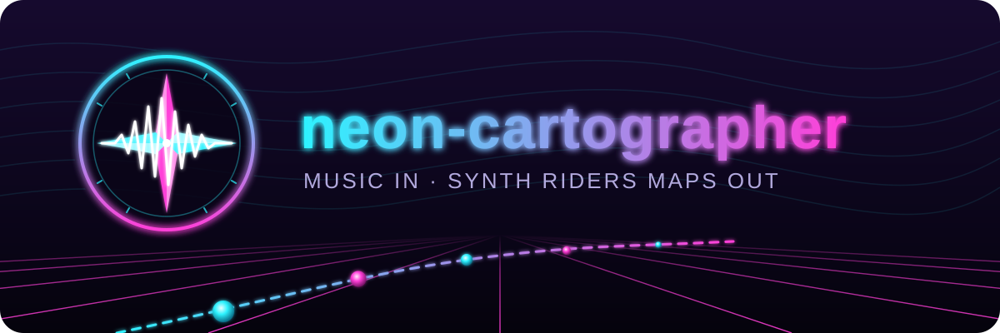

<p align="center">
  
</p>

# neon-cartographer

Generate playable [Synth Riders](https://synthridersvr.com/) custom maps (`.synth`) from music files. The
maps open in the official Synth Riders Beatmap Editor (tested with 1.9.7) and play on Meta Quest.

```
ncart -in song.mp3 -out song.synth -difficulties easy,normal,hard,expert
```

neon-cartographer finds the tempo and beat grid, detects onsets in low/mid/high bands, sections (calm/intense,
drops), sustained tones and accents. It then places notes per difficulty under explicit playability
rules. Synth Riders is played by *touching* orbs, so the main constraint is how far a hand must travel in
the time available.

## Requirements

- **Go 1.24+** to build.
- **sox** (required to write maps): the editor needs Ogg Vorbis audio and sox encodes it.
  `brew install sox` (macOS) or your package manager.
- **ffmpeg** (optional): reads title/artist tags and embedded cover art, and decodes formats other than
  MP3/OGG/WAV. If only ffmpeg is present (no sox), its built-in Vorbis encoder is used with a quality
  warning.

```
go install github.com/stefankn/neon-cartographer/cmd/ncart@latest
```

or from a clone:

```
git clone https://github.com/stefankn/neon-cartographer.git
cd neon-cartographer
go build -o ncart ./cmd/ncart
```

## Usage

### Generate a map

```
ncart -in song.mp3 [-out song.synth] [-difficulties easy,normal,hard,expert,master]
      [-title "…"] [-artist "…"] [-mapper neon-cartographer] [-bpm 128] [-half-beat] [-offset-ms 0] [-seed 42]
      [-walls] [-no-cover] [-debug analysis.json]
```

| flag | meaning |
|---|---|
| `-difficulties` | any of easy, normal, hard, expert, master (default: easy,normal,hard,expert) |
| `-title`, `-artist` | default: the file's tags, else the file name |
| `-bpm` | override tempo detection (use it if the detected tempo is half/double) |
| `-half-beat` | move the beat grid by half a beat, if `analyze -beat-test` shows the beat on the high tick |
| `-offset-ms` | move all notes later (+) or earlier (−) if the timing feels off |
| `-seed` | same seed → identical map; another seed → different patterns |
| `-walls` | add a few side walls in calm sections (Hard and up) |
| `-debug` | write the full analysis (beats, onsets, energy, sections) as JSON |

`generate` prints a summary and a validation table. It fails if the written map breaks any rule (that
would be a bug).

```
          notes  rails specials  walls   NPS avg  NPS peak   hand speed L/R (limit) violations
Easy        224     26        2      0      0.87      1.75       0.97/0.97 (1.0) m/s          0
Normal      411     34       20      0      1.59      3.25       1.46/1.46 (1.5) m/s          0
…
```

### Check a map

```
ncart validate song.synth [-difficulty hard] [-list 10]
```

Works on any `.synth`, including editor-made maps (not on encrypted downloads from synthriderz.com). For
each difficulty it reports note/rail/special/wall counts, notes per second (average, and the peak over
4 s), the hand speed needed (comparable to the limit), and every rule violation. Exit code 1 if anything
is wrong.

### Inspect the analysis

```
ncart analyze -in song.mp3 [-bpm 128] [-half-beat] [-debug analysis.json] [-clicks check.wav]
              [-beat-test beat.wav]
```

Prints BPM, beat grid, onset counts, sections and sustains. `-clicks` writes the song with a click on
every detected beat (higher click = start of a bar), so you can **hear** whether the grid is right.

**Check the beat before mapping a new song:** `-beat-test` writes the song with a low tock on every
detected beat and an equally loud high tick halfway between. Nod or clap along to the *music*: if you
land on the high tick, the detected grid is half a beat off (it happened on both test songs) — pass
`-half-beat` to `generate` (and `analyze`). Clicks that coincide with a drum hit are hard to hear, so
judge with the beat test rather than `-clicks` alone.

## Getting the map into the game

### Beatmap Editor (PC)

Copy the `.synth` into the editor's `CustomSongs` folder, e.g.
`C:\Program Files (x86)\Steam\steamapps\common\Synth Riders Beatmap Editor\CustomSongs\`, then open it in
the editor. Sections are bookmarked.

### Meta Quest

1. Enable developer mode on the headset and connect it via USB.
2. Copy the `.synth` into **`SynthRidersUC/CustomSongs/`** in the headset's storage (`/sdcard/SynthRidersUC/CustomSongs/`),
   either with **SideQuest** (Manage files) or any MTP file manager (on macOS e.g. *Android File Transfer*
   or *OpenMTP*). This folder is confirmed working on a Quest 3. If it doesn't exist yet, start Synth
   Riders once.
3. Start Synth Riders and open *Custom Songs*. If the song doesn't appear, use the game's refresh/reimport
   option for custom songs or restart the game.

## How it works

```
audio      decode (MP3/OGG/WAV natively, others via ffmpeg) → mono 44.1 kHz
analysis   STFT 2048/512 Hann → spectral flux per band (low/mid/high) → adaptive peak picking
           tempo: autocorrelation + comb + log-Gaussian prior (half/double), then a joint fine search of
           BPM (0.01) and phase over the whole song, so one BPM holds without drift
           grid snapping (1/1, 1/2, 1/4), RMS per beat/bar, calm/normal/intense phrases, drops,
           sustained tones (rail candidates), accents (low+high together), a tone per onset
           (flux-weighted mean log frequency, 100 Hz – 4 kHz)
mapper     slots → notes per bar (main beats first; bars with a similar rhythm get the same notes)
           → rails → hand assignment → positions: height from each sound's tone (higher sounds
           higher), sideways from phrase patterns (arc, zigzag, rise, circle, steps, diamond) with
           8-bar motifs, move size from loudness, repeated bars repeat their positions within a
           phrase → placement under the rules → walls
rules      hand-motion model shared by the mapper and `validate`
synthfile  .synth read/write (format notes: docs/synth-format.md)
```

Timing: the exported audio gets < 1 beat of silence prepended so every beat lands on the editor grid with
`Offset 0`. The exported Ogg is then decoded and cross-correlated with the original, and any decoder
offset is corrected.

### Playability rules (per difficulty)

- **Hand speed:** distance between consecutive touches of one hand ≤ speed limit × time + 0.10 m.
- **Comfort zone:** x −6…6, y −3…4 grid cells (1 cell = 13.65 cm). Each hand stays on its side; Hard+
  may cross 2 cells past the centre.
- **Simultaneous notes:** at least 3 cells apart, left hand's note left of the right hand's.
- **No long same-hand streams:** Easy 2, Normal 3, Hard 4, Expert 6, Master 8.
- **Lead-in:** ≥ 2 s before the first note. No notes during silence.
- **Rails:** the rail hand gets no other notes. The other hand keeps its distance from the rail.
- **Two-hand specials:** on drops/section starts, and on strong accents (Normal+), never together with
  other notes.

## Tuning

Every tuning value lives in one place with comments:

- `internal/config/mapper.go`: difficulty table (density per section, grid, hand speed, runs, crossovers,
  specials, rails, walls) and geometry.
- `internal/config/config.go`: analysis (bands, onset thresholds, tempo range, sections, sustains) and
  export (Ogg quality, cover size).

Typical adjustments after playing: lower `Density` for a difficulty that feels too busy (it is applied
per bar: round(Density × 4) notes), or lower `MaxHandSpeed` if moves feel rushed. If the rhythm keeps
only main beats where you'd want off-beats, lower the metric weights (`DownbeatWeight` … `HalfWeight`);
if repeated bars still vary, lower `RhythmSimilarity`. Height and movement: `ToneWeight` / `ToneRangeY`
(how much and how far height follows the sound), `SpreadMin` / `QuietDB` (how small moves get in quiet
parts), `RepeatToneOctaves` (how alike two bars must sound to repeat their positions). Use `-offset-ms` if every note feels early or late.

## Project status

Built in four milestones; all are done and verified:

1. **File format:** `.synth` documented in `docs/synth-format.md` and confirmed against a map saved by
   the official editor 1.9.7. Lossless read/write round trip. Encrypted synthriderz.com downloads are
   detected and rejected with a clear error.
2. **Audio and analysis:** native MP3/OGG/WAV decoding (ffmpeg fallback), resampling, onset detection
   per band, tempo with drift-free fine search, beat grid, sections, sustains, accents. On the test song
   (Bonobo – Drift): 126.00 BPM, grid within ±5 ms of the kicks over 4.5 minutes.
3. **First playable map:** notes on beats, Ogg export with sample-accurate alignment. It loads in the
   editor with title, artist, cover and bookmarks, and notes are on the grid and on the beat.
4. **Full mapper:** five difficulties with density per section, hand assignment, hand-speed and
   comfort-zone rules, phrase patterns with motifs, rails, two-hand specials, optional walls, the
   `validate` command and this README. It plays in the editor and on the Quest.

**Next:** tuning the difficulty values from play-testing (density, hand speed, patterns, rail
frequency). See [Tuning](#tuning).

## Development

```
go test ./...      # unit tests (synthetic signals) + an end-to-end test (needs sox or ffmpeg)
go vet ./...
gofmt -l .         # must print nothing
```

With [just](https://github.com/casey/just) installed, there are shortcuts (optional):

```
just build         # build the binary to ./ncart
just test          # all tests; extra flags pass through: just test -run Tone -v
just check         # vet + gofmt (fails if a file needs formatting) + tests; run before committing
just demo          # map the test song (all difficulties, walls) to out/demo.synth and validate it
just analyze       # analysis summary, out/analysis.json and click track out/check.wav
```

`demo` and `analyze` need the test song (see below).

`reference/editor-sample.synth` (a map saved by the official editor) is used by the format tests. Its
audio is replaced by one second of silence; the map data is unchanged editor output.
`docs/synth-format.md` documents the file format.

**Test song (not in the repository).** The analysis was tuned on Bonobo – "Drift" (126 BPM, 4:30),
which is commercial audio and is therefore not committed (`/testdata/*.mp3` is git-ignored). To use
it, place your own copy at `testdata/bonobo-drift.mp3`. `TestDecodeMP3TestSong` and the example
commands use it; without the file that test is skipped and everything else runs on synthetic signals.
Any other song works for the manual commands; pass `-bpm` if the tempo is detected at half speed.

## License

[MIT](LICENSE). Dependencies are under their own permissive licenses (Apache-2.0, MIT, BSD-3-Clause).

neon-cartographer is an unofficial fan tool and is not affiliated with or endorsed by the makers of Synth Riders.
It doesn't include any music. Only map songs you have the rights to use, and don't redistribute
generated maps that contain copyrighted audio without permission.
